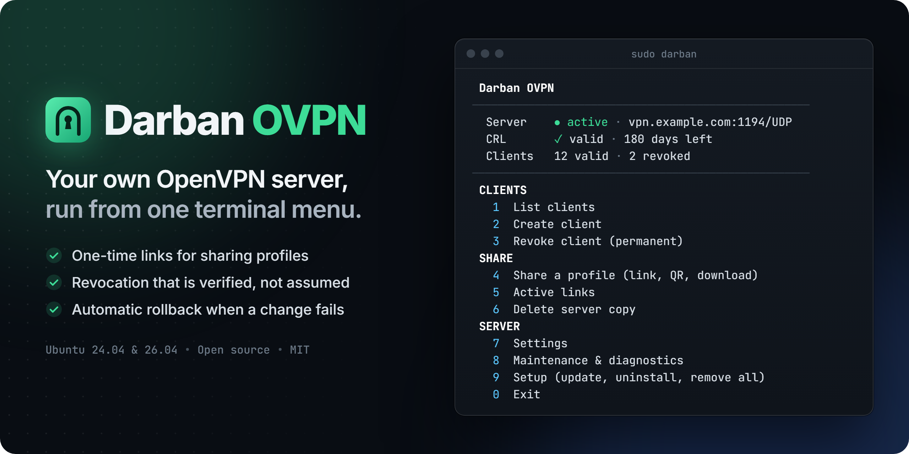
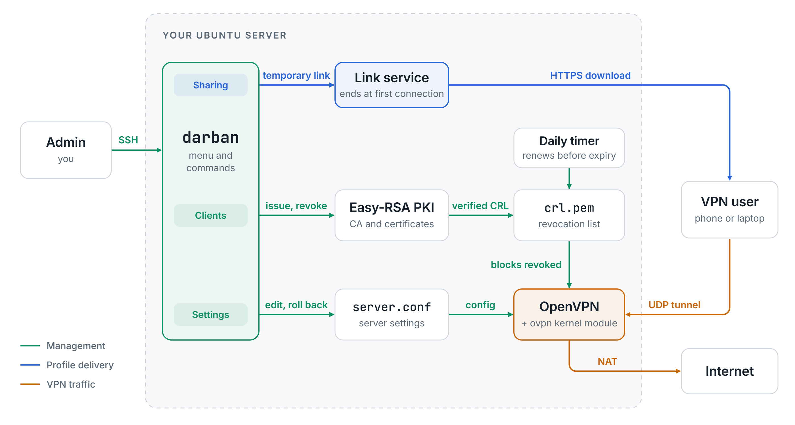

<div dir="rtl">

**با دربان، سرور OpenVPN خود را روی یک VPS تازه با Ubuntu 24.04 یا 26.04 نصب و از یک منوی ترمینال مدیریت کنید.**

[English](README.md) · [شروع کار](docs/fa/getting-started.md) · [اتصال دستگاه](docs/fa/connect-devices.md) · [کارهای روزمره](docs/fa/usage.md) · [عیب‌یابی](docs/fa/troubleshooting.md) · [مطالعهٔ موردی (انگلیسی)](docs/case-study.md)

> **نسخهٔ پیش از انتشار:** این نسخه هنوز در مرحلهٔ آزمایش روی سرور واقعی است. ابتدا آن را روی یک VPS آزمایشی امتحان کنید.

دربان OpenVPN را نصب می‌کند و کارهای روزمرهٔ آن را انجام می‌دهد: ساخت کلاینت، اشتراک پروفایل، ابطال دسترسی و نگه‌داری فهرست گواهی‌های باطل‌شده (CRL). هر تغییر پرخطر پیش از اجرا تأیید می‌خواهد و اگر شکست بخورد، تا جای ممکن خودکار برمی‌گردد.

## نصب یا به‌روزرسانی

روی **یک VPS تازه با Ubuntu 24.04 یا 26.04**، از راه اتصال مستقیم SSH. همین دستور، نصب موجود را هم به‌روز می‌کند. تا انتشار `v1.0.0`، نسخهٔ کاندید نصب می‌شود:

</div>

```bash
sudo bash -c 'curl -fsSL https://github.com/MohZeh/Darban-OVPN/releases/download/v1.0.0-rc.4/get.sh | bash'
```

<div dir="rtl">

برای پذیرفتن آدرس و پورت پیشنهادی Enter بزنید و با Enter بعدی نصب را شروع کنید. پس از نصب، ابزار ساخت اولین کلاینت را پیشنهاد می‌دهد، پروفایل آن را به اشتراک می‌گذارد و وقتی اتصال برقرار شد، خبر می‌دهد.

**برای باز کردن دوبارهٔ منو**، با SSH به سرور وصل شوید و دستور زیر را اجرا کنید. بستن منو VPN را متوقف نمی‌کند.

</div>

```bash
sudo darban
```

<div dir="rtl">

**[راهنمای گام‌به‌گام](docs/fa/getting-started.md)** مسیر را از سرور تازه تا اولین کاربر متصل توضیح می‌دهد. نسخهٔ کاندید برای آزمایش منتشر شده است؛ آن را روی سروری امتحان کنید که در حال استفاده نیست.

## چرا دربان

- **راه‌اندازی در چند دقیقه.** در هر مرحله، Enter یک پیش‌فرض قابل استفاده را می‌پذیرد و در پایان اتصال اولین کلاینت را می‌بینید.
- **اشتراک موقت پروفایل.** لینک با پایان مهلتش، یا وقتی اتصالی با همان پروفایل دیده شود، از کار می‌افتد. پیش‌نمایش پیام‌رسان‌ها لینک را مصرف نمی‌کند.
- **ابطال قابل بررسی.** CRL منتشرشده با پایگاه CA مقایسه می‌شود و اگر کلاینتی باطل شده ولی هنوز مسدود نشده باشد، نامش تا رفع مشکل نشان داده می‌شود.

## قابلیت‌ها

**کلاینت‌ها**
- ساخت، فهرست و ابطال کلاینت، همراه با تاریخ انقضای هر گواهی
- صدور گواهی تازه با نامی که قبلاً باطل شده است؛ پروفایل‌های قدیمی همچنان مسدود می‌مانند
- نمایش همهٔ گواهی‌های معتبر، و دلیل هر گواهی‌ای که از منو قابل مدیریت نیست
- نمایش کلاینت‌های متصل، و قطع اتصال یک کلاینت بدون قطع بقیه، وقتی رابط مدیریت OpenVPN در دسترس باشد

**اشتراک**
- لینک موقت با مهلت حداکثر ۲۴ ساعت، ۱ ساعت یا ۱۵ دقیقه، که با دیده شدن اتصالِ همان پروفایل زودتر تمام می‌شود؛ همچنین QR
- گواهی معتبر برای لینک، برای دامنه یا IP عمومی: گواهی موجود روی سرور، یا گواهی رایگان Let's Encrypt
- رمز اختیاری روی کلید خصوصی، برای لینکی که گواهی معتبر ندارد
- دستور `scp` و `sftp` مخصوص سیستم‌عامل شما

**سرور**
- تمدید روزانهٔ CRL، همراه با جلوگیری از برگشت بی‌صدای ابطال‌ها هنگام بازیابی یک پشتیبان قدیمی از CA
- تنظیمات پیشرفتهٔ مسیر ترافیک، DNS، شبکه، رمزنگاری و keepalive، با برگشت خودکار در صورت شکست
- محدودسازی TCP MSS برای ترافیک VPN، تا سایت‌ها روی شبکه‌هایی که بسته‌های تکه‌شده را دور می‌ریزند هم باز شوند
- اعلان نسخهٔ جدید در منو، و به‌روزرسانی و برگشت به نسخهٔ قبل از داخل خود ابزار
- ادامه یا برگرداندن نصب نیمه‌کاره در اجرای بعدی
- عیب‌یابی، به‌روزرسانی و حذف، حتی روی سروری که درست کار نمی‌کند
- حذف فقط چیزهایی که خود نصب اضافه کرده است

## چطور کار می‌کند

</div>

<picture>
  <source media="(prefers-color-scheme: dark)" srcset="docs/assets/how-it-works-dark.png">
  
</picture>

<div dir="rtl">

مسیر سبز مدیریت است، آبی تحویل پروفایل و نارنجی ترافیک VPN. ابزار با Bash نوشته شده است و یک سرویس کوچک Python فقط تا وقتی لینکی فعال باشد اجرا می‌شود.

## مدل امنیتی

- کلاینت‌ها از راه سرور به یکدیگر و به سرویس metadata ارائه‌دهندهٔ ابری دسترسی ندارند.
- پروفایل کلید خصوصی دارد؛ به همین دلیل هر لینک مهلت دارد و لینک دائمی وجود ندارد. می‌توانید برای لینکی که گواهی معتبر ندارد، روی کلید رمز بگذارید و رمز را از راه دیگری بفرستید.
- از توکن هر لینک فقط هش آن روی سرور می‌ماند و خود توکن در لاگ ثبت نمی‌شود.
- کلید CA رمز ندارد، چون تمدید روزانهٔ CRL باید بدون حضور مدیر انجام شود. **هر کس به دسترسی root سرور برسد، می‌تواند گواهی صادر کند.** پس از سرور محافظت کنید و یک پشتیبان رمزگذاری‌شده بیرون از سرور نگه دارید.
- به‌روزرسانی با هش منتشرشده در همان نسخه بررسی می‌شود. این بررسی دانلود خراب را تشخیص می‌دهد، نه دستکاری حساب GitHub را.

برای گزارش آسیب‌پذیری، [SECURITY.md](SECURITY.md) را ببینید.

## محدودیت‌های شناخته‌شده

- نصب سرور فقط روی Ubuntu 24.04 و 26.04 پشتیبانی می‌شود، با یک سرور OpenVPN، `udp4` و ساختاری که در [راهنمای پیشرفته](docs/fa/advanced.md) آمده است.
- فقط ترافیک IPv4 از VPN عبور می‌کند. کلاینتی که خودش IPv6 دارد، ترافیک IPv6 را مستقیم می‌فرستد.
- گواهی‌های کلاینت، سرور و CA خودکار تمدید نمی‌شوند؛ فقط CRL تمدید می‌شود.

## وضعیت پروژه

آزمون‌های خودکار در هر تغییر کد و هفته‌ای یک بار، جداگانه روی Ubuntu 24.04 و 26.04 اجرا می‌شوند. این آزمون‌ها نصب واقعی با پاسخ در یک ترمینال واقعی، عبور ترافیک واقعی کلاینت از تونل و NAT، ابطال، برگشت خودکار، به‌روزرسانی و حذف کامل را بررسی می‌کنند. یک ماشین مجازی هم Reboot واقعی و DCO را می‌آزماید. فایروال ارائه‌دهنده، شبکه‌های واقعی و برنامه‌های کلاینت پیش از انتشار `v1.0.0` روی سرور واقعی بررسی خواهند شد. فهرست تغییرها در [تاریخچهٔ تغییرات](CHANGELOG.md) آمده است.

## راهنماها

| راهنما | کاربرد |
|---|---|
| [شروع کار](docs/fa/getting-started.md) | از سرور تازه تا اولین کاربر متصل |
| [اتصال دستگاه](docs/fa/connect-devices.md) | برای کسی که لینک یا فایل گرفته است: Android، iPhone، Windows، macOS و Linux |
| [کارهای روزمره](docs/fa/usage.md) | افزودن و ابطال کلاینت، به‌روزرسانی و فهرست دستورها |
| [اشتراک پروفایل](docs/fa/sharing.md) | لینک، QR، کامپیوتر خودتان و رمز کلید |
| [عیب‌یابی](docs/fa/troubleshooting.md) | وقتی چیزی کار نمی‌کند |
| [پیشرفته](docs/fa/advanced.md) | خواندن اسکریپت پیش از اجرا، نصب بدون پرسش، سرور موجود، تنظیمات و پشتیبان |
| [واژه‌نامه](docs/fa/glossary.md) | معنی اصطلاح‌ها |

## مشارکت

گزارش خطا و Pull Requestهای متمرکز پذیرفته می‌شوند. پیش از شروع، [CONTRIBUTING.md](CONTRIBUTING.md) را بخوانید.

## راه‌اندازی روی سرور شما

اتوماسیون برای سرورهای Linux، VPN و اتصال سیستم‌ها می‌سازم و نگهداری می‌کنم. برای نصب، سخت‌سازی یا کار سفارشی: **[zehtabex@gmail.com](mailto:zehtabex@gmail.com)**

## مجوز

[MIT](LICENSE). دربان یک پروژهٔ مستقل است؛ به OpenVPN Inc. وابسته نیست و از سوی آن تأیید نشده است. OpenVPN علامت تجاری ثبت‌شدهٔ OpenVPN Inc. است.

</div>
