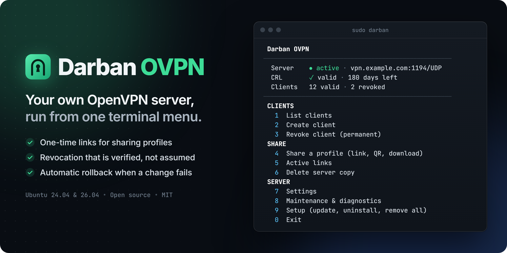

<div align="center">

**Run your own OpenVPN server from one terminal menu, on a clean Ubuntu 24.04 or 26.04 VPS.**

[](https://github.com/MohZeh/Darban-OVPN/actions/workflows/ci.yml)
[](https://github.com/MohZeh/Darban-OVPN/releases)
[](LICENSE)


[فارسی](README.fa.md) · [Getting started](docs/en/getting-started.md) · [Connect a device](docs/en/connect-devices.md) · [Everyday tasks](docs/en/usage.md) · [Troubleshooting](docs/en/troubleshooting.md) · [Case study](docs/case-study.md)

</div>

> [!WARNING]
> **Pre-release.** This version is being tested on real servers. Try it on a disposable VPS first. See [Project status](#project-status).

Darban (دربان, "gatekeeper") installs a current OpenVPN server and then handles the daily work: creating clients, delivering their profiles safely, revoking access, and keeping the revocation list valid. Every risky change is confirmed first and, where possible, rolled back automatically if it fails.

## Install or update

On a **fresh Ubuntu 24.04 or 26.04 VPS**, connected through direct SSH. The same command also updates an existing installation. Until `v1.0.0` is out, it installs the release candidate:

```bash
sudo bash -c 'curl -fsSL https://github.com/MohZeh/Darban-OVPN/releases/download/v1.0.0-rc.2/get.sh | bash'
```

Press Enter to accept the suggested address and port, and Enter again to install. The tool then offers to create your first client, shares it, and tells you when it connects.

**To open the menu later**, connect to the server over SSH and type the command below. The VPN keeps running when you leave the menu.

```bash
sudo darban
```

**[Follow the step-by-step guide](docs/en/getting-started.md)**, from a new server to your first connected user. A release candidate is for testing: try it on a server that is not in use.

## Why Darban

- **A server in minutes.** Enter accepts a working default at every step, and you see your first client connect.
- **Profiles that travel safely.** A link stops working when its time is up, or once a connection with its profile is seen, and a messenger's preview cannot use it up.
- **Revocation you can trust.** The revocation list is checked against the CA, and a client that is not really blocked is named until it is.

## Features

**Clients**
- Create, list and revoke clients, with clear expiry information
- Issue a new certificate under a revoked name; old profiles stay blocked
- See every valid certificate, and why one cannot be managed if that is the case
- See who is connected, and end one client's session without touching the others, when OpenVPN's management interface is available

**Sharing**
- Temporary links valid for at most 24 hours, 1 hour or 15 minutes, which end sooner once a connection with their profile is seen, and QR codes
- A trusted certificate for links, for a domain name or a public IP address: one already on the server, or a free one from Let's Encrypt
- Optional short password on the private key, for links without a trusted certificate
- `scp` and `sftp` commands for your own operating system

**Server**
- Daily CRL renewal, with protection against a restored old CA database silently un-revoking clients
- Advanced settings for routing, DNS, network, ciphers and keepalive, with automatic rollback
- TCP MSS for VPN traffic is limited, so websites also open on networks that drop split packets
- Update notice in the menu, update and restore from inside the tool
- A setup that stops half way continues on the next run, or can be undone
- Diagnostics, updates and removal keep working on a broken server
- Clean removal: only what the setup itself added

## How it works

<picture>
  <source media="(prefers-color-scheme: dark)" srcset="docs/assets/how-it-works-dark.png">
  
</picture>

Green is management, blue is profile delivery and orange is VPN traffic. The tool is written in Bash, with a small standard-library Python service that runs only while a link exists. See [the case study](docs/case-study.md) for the reasoning behind the main decisions.

## Security model

- A profile holds a private key, so every link has a time limit, and there are no permanent links. A short password on the key can be added for a link without a trusted certificate, and sent another way.
- Clients cannot reach each other, or the cloud provider's metadata service, through the server.
- Only a hash of each link token stays on the server, and tokens never reach the logs.
- The CA key has no passphrase, because the daily CRL renewal must run unattended. **Anyone who gains root on the server can issue certificates**, so protect the server and keep an encrypted backup elsewhere.
- Updates are checked against a checksum published with the release. This detects a damaged download, not a compromised GitHub account.

Report vulnerabilities as described in [SECURITY.md](SECURITY.md).

## Known limits

- Only Ubuntu 24.04 and 26.04 are supported for server setup, with one OpenVPN server, `udp4`, and the layout described in [Advanced](docs/en/advanced.md#a-server-that-already-runs-openvpn).
- Only IPv4 goes through the VPN. A client with its own IPv6 connection uses it directly for IPv6.
- Client, server and CA certificates are not renewed automatically; only the CRL is.

## Project status

Automated tests run on every code change and once a week, separately on Ubuntu 24.04 and 26.04. They include a real installation answered in a real terminal, real client traffic through the tunnel and NAT, revocation, rollback, updates and full removal. A virtual machine also proves a real reboot and DCO. A provider's firewall, real networks and client apps are being checked on real servers before `v1.0.0`. Changes are listed in the [changelog](CHANGELOG.md).

## Guides

| Guide | For |
|---|---|
| [Getting started](docs/en/getting-started.md) | From a new server to your first connected user |
| [Connect a device](docs/en/connect-devices.md) | The person receiving a link: Android, iPhone, Windows, macOS, Linux |
| [Everyday tasks](docs/en/usage.md) | Adding and removing people, updating, all commands |
| [Sharing a profile](docs/en/sharing.md) | Links, QR codes, your own computer, passwords |
| [Troubleshooting](docs/en/troubleshooting.md) | What to do when something does not work |
| [Advanced](docs/en/advanced.md) | Reading the script first, unattended install, existing servers, settings, backup |
| [Glossary](docs/en/glossary.md) | What the words mean |

## Contributing

Bug reports and focused pull requests are welcome. Please read [CONTRIBUTING.md](CONTRIBUTING.md).

## Need this on your server?

I build and maintain automation for Linux servers, VPNs and integrations. For installation, hardening or custom work: **[zehtabex@gmail.com](mailto:zehtabex@gmail.com)**

## License

[MIT](LICENSE). Darban OVPN is an independent project, not affiliated with or endorsed by OpenVPN Inc. OpenVPN is a registered trademark of OpenVPN Inc.
